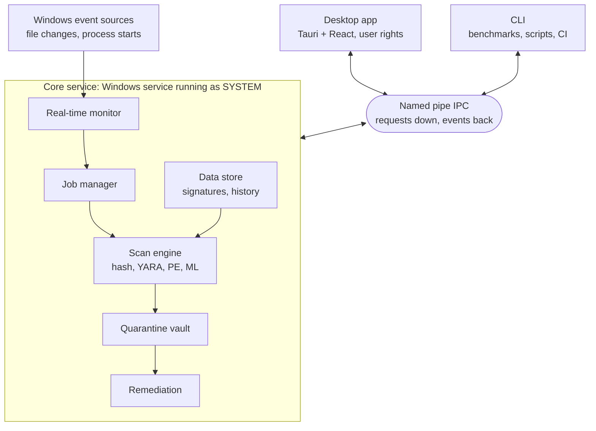
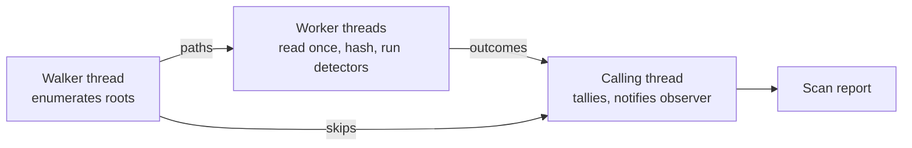

# Architecture

This document describes the design Warden is being built towards and marks
what exists today. The phases are in [ROADMAP.md](ROADMAP.md).

**Implemented so far (phases 1 to 4, and the first piece of phase 5):** the
engine library, the signature database, hash matching, YARA rules, zip
scanning, the heuristic layer, a verdict policy in which a finding can
depend on a second sign and can yield to a trusted signature, the
quarantine, the check of who signed a file, and the command-line tool.

## Scope

Warden is a second-opinion scanner for Windows that runs next to Microsoft
Defender. It is a portfolio project, and its goal is depth in the scan
engine, a clean architecture and measured results, not feature parity with a
commercial product.

What a product such as Malwarebytes has and Warden will not:

- **Threat intelligence.** A vendor's detection quality comes from its
  research team, its telemetry and constant updates. Warden's signatures come
  from public feeds, so its coverage will trail a vendor's by a wide margin.
- **Kernel components for distribution.** Blocking a file before it runs,
  behaviour-based ransomware protection, exploit protection, web filtering
  and rootkit scanning all need kernel drivers. Distributing one requires
  Microsoft's signature, which requires an EV certificate.
- **Protected-process status and Security Center registration.** Both are
  reserved for vendors in Microsoft's Virus Initiative, which is for
  commercially available products.

What Warden does instead is stated as a threat model: it resists
unprivileged malware and casual tampering, detects modification of its own
files, and does not resist an attacker with administrator rights.

## Processes



- **Core service** (phase 6). A Windows service running as SYSTEM. It owns
  the engine, the signature store, the quarantine vault, remediation, the
  real-time monitor and all state. Anything that needs privilege, or must
  keep running with nobody logged in, lives here.
- **Desktop app** (phase 7). Tauri with a React front end, running with the
  user's normal rights. A thin client with no engine code; it cannot delete
  or restore anything by itself.
- **CLI** (phase 1, exists). The same engine linked directly, for
  benchmarks, CI and scripting. From phase 6 it can also drive the service.

The processes talk over a local named pipe with length-prefixed JSON:
requests go down, progress and detection events come back. The service
treats every client as untrusted and checks each request against the
caller's Windows token. Anything that weakens protection (restoring from
quarantine, adding exclusions, switching real-time protection off) needs an
elevated caller.

## Design rules

1. **The engine is a plain library.** No user interface, no service code and
   no Windows-only APIs beyond a few file-opening hints. It can be tested,
   benchmarked and fuzzed in isolation, on any platform. Where it needs
   something only Windows can answer, such as who signed a file, it says
   what it needs as a trait and a client hands it the answer.
2. **Detectors report, a policy decides.** A detector returns findings, each
   with a confidence and human-readable reasons. A separate verdict policy
   turns the findings for a file into clean, suspicious or malicious. Every
   detection can therefore answer "why was this flagged?", and a new
   detector never needs to know what the product does about a finding. A
   detector may also say that its finding is not enough alone; whether
   something backs it up is again for the policy to see, not for the
   detector.
3. **Nothing is destroyed.** Quarantine is journaled and reversible. A
   guard that refuses to quarantine signed Windows system files belongs to
   this rule, because a false positive there can stop Windows from
   starting. It is not built yet. What it was waiting for exists now:
   `warden-trust` can tell a file that Windows itself signed. Until the
   guard exists, nothing is quarantined unless a person names the file.
4. **Files are hostile input.** Parsers get limits, and fuzz targets from
   phase 3 on. A file that cannot be read is reported as skipped with a
   reason, and a file that could only be checked in part is reported as
   such, with what was left out. Neither is ever silently dropped. A
   folder that cannot be opened is reported as a folder and counted apart
   from files, because nobody knows how many files it stands for. A
   detector that panics costs one file, not the scan.

## Workspace layout

```
crates/
  warden-sigdb/     signature database: format, builder, reader, importers
  warden-engine/    detector interface, verdict policy, the parallel scan
                    pipeline, zip unpacking, the hash detector
  warden-yara/      YARA layer: rule bundles and the detector that runs them
  warden-pe/        heuristic layer: a reader for Windows executables, the
                    indicators with their weights, the score, the detector,
                    and inert executables for tests
  warden-quarantine/
                    the quarantine: the entry format, the journal that
                    settles interrupted operations, and what a file has
                    besides its content on Unix and on Windows
  warden-trust/     who signed a file: the three routes to a signature,
                    the trust list, and the one module that asks Windows
  warden-cli/       the `warden` command-line tool
  warden-calibrate/ development tool: measures the indicators on a public
                    dataset and fits their weights; not part of the scanner
calibration/        the counts the weights are fitted to, and the report
docs/               this document, the roadmap, format specs, testing, benchmarks
fuzz/               fuzz targets for the parsers
rules/              which public rule release the rule bundle is built from,
                    and which of its rules are left out, with the evidence
trust/              the publishers whose signature Warden trusts, with the
                    evidence
scripts/            fetch and check scripts, for Linux and Windows
```

The YARA layer is a crate of its own because its rule engine is a large
dependency. The engine crate stays small and builds in seconds; only what
needs YARA pays for it. The heuristic layer is a crate of its own for the
opposite reason: it depends on nothing but the engine's detector interface,
so the calibration tool and the fuzzers can use it without the rest.

The quarantine depends on neither the engine nor the detection layers: it
moves files, whoever asks. Of the other crates it uses one function, the
signature database's helper that writes bytes as hexadecimal.

The signature check is a crate of its own because it is the one part of a
scan that talks to Windows at length, through functions that need `unsafe`
code. It implements a trait of the engine, as the detection layers do, and
the engine never learns what a certificate is.

Crates planned for later phases: `remediation`, `realtime`, `ipc`,
`service`, and the Tauri app.

## The scan pipeline

Implemented in `warden-engine`.



1. A **walker** thread enumerates the scan roots and queues every regular
   file. It does not follow symbolic links or junctions, and it skips cloud
   placeholders (OneDrive files that are not on disk), because reading them
   would download them.
2. **Worker** threads take paths from a bounded queue. Each file is opened
   without blocking other programs and read exactly once. Its SHA-256 is
   computed on the way.
3. Files up to a size limit are buffered once and shared by all detectors.
   Larger files are still hashed, in a streaming fashion with constant
   memory, and still checked by hash; the report lists them as checked in
   part.
4. Each **detector** inspects the file and returns findings. A detector is
   shared and read-only: signatures, compiled rules. What a thread needs to
   itself, such as a YARA scanner, lives in a **session** that the detector
   hands out once per worker thread.
5. If the file is a zip archive, its members are unpacked in memory and go
   through the same detectors, see [Archives](#archives).
6. The **verdict policy** first settles which findings count, then
   decides clean, suspicious or malicious from those, the file's members
   included. See [the verdict policy](#the-verdict-policy). If a finding
   that yields to a trusted signature would be reported, the worker first
   asks [who signed the file](#who-signed-a-file).
7. The **calling thread** collects outcomes, so an observer (a progress
   line today, the service's event stream later) needs no locking.

Both queues are bounded, which gives back-pressure: the walker cannot run
far ahead of the workers and fill memory with paths. A scan can be cancelled
at any time and still returns a report of what it covered.

### Detection layers

| Layer | Phase | What it catches | Its weakness |
|---|---|---|---|
| Hash match | 1, done | Exact copies of known files | One changed byte evades it |
| YARA rules | 2, done | Byte patterns and structure shared by a family | Packing and encryption hide the patterns |
| PE heuristics | 3, built | Executables nobody has seen that are built the way malware often is: packed, with no imports, with the entry point where no linker puts it | Clean software is packed too, and malware can be built to look plain. Says little about libraries and .NET assemblies |
| ML classifier | 11, optional | Statistical resemblance to known malware | Opaque, and only as good as its training data |

The layers run in that order, the most certain first, and a file gets the
verdict of its strongest finding that counts. The heuristic layer can make
a file suspicious and never malicious.

Whether a file carries a signature is not part of the heuristic score,
because the presence of a signature proves nothing: one can be appended to
any file. A signature that Windows has checked is another matter, and since
phase 5 Warden has such a check. What it changes is narrow: the valid
signature of a publisher on a short list sets aside the match of a rule
that came with a bundle. It does not lower a heuristic score, and it does
not touch a hash match or the match of a built-in rule. See
[Who signed a file](#who-signed-a-file).

How a rule match becomes a verdict, where rules come from, which rules are
left out because they flag clean files, and what a rule bundle looks like on
disk is in [RULES.md](RULES.md).

### The verdict policy

Implemented in `warden-engine`. A finding says how it counts, in one of
three ways:

| A finding counts | Who reports such a finding | What the policy does with it |
|---|---|---|
| alone | The hash layer, hand-written YARA rules, the heuristic layer from its threshold on | Takes it as it is |
| with a second sign | A YARA rule that a tool generated | Lets it count if another detector has something to say about the same file. Otherwise it stays on record and the verdict is what it would be without it |
| as a second sign | The heuristic layer, for a score below its threshold and above a lower bar | Uses it to back up a finding of the second kind. If none waits for it, it is dropped |

Two rules keep this honest. A detector does not back itself: two generated
rules that match one file are one layer saying the same thing twice. And
it is settled per file, and inside an archive per member: a rule match in
one member and an odd structure in another do not add up.

A finding can also say that it **yields to a trusted signature**. That is
for evidence that is known to be wrong about clean software now and then:
the match of a rule from a bundle says it, and nothing else does. If such a
finding would be reported, the worker asks who signed the file. With the
signature of a trusted publisher, the yielding findings are set aside
before anything else is settled: they stay on record with low confidence,
say why, and are nobody's second sign. Every other finding counts as it
would without the signature.

After that the strongest finding that counts decides, as before: high
confidence is malicious, medium is suspicious, low changes nothing.

A scan report keeps the findings that did not count, in a list apart from
the detections. So a report can answer "why was this file not flagged?",
and a false-positive run can show that a file was scanned and what
happened to its finding. Why generated rules are treated this way, and
what it costs, is in [RULES.md](RULES.md#generated-rules).

### The heuristic layer

Implemented in `warden-pe`, in three steps that can each be used alone.

1. A **reader** turns the bytes of a Windows executable into facts: its
   sections with sizes, flags and entropy, what it imports, which tables
   its header points to, what follows its last section. It is written for
   hostile input: every offset and count comes from the file, so each is
   checked against the file before use and every loop has a limit.
2. **Indicators** are yes-or-no questions about those facts, such as "is a
   section both writable and executable?". Each has a weight.
3. The **score** is the sum of the weights of the indicators that apply. A
   file whose score reaches the threshold is reported as suspicious, with
   one reason per indicator. A score below the threshold and above a lower
   bar is reported as a second sign, which counts only next to a finding
   that waits for one.

The reader is Warden's own, and small, for two reasons. A general-purpose
parser treats a file that contradicts itself as an error; for this layer it
is a finding. And the facts are exactly those that the
EMBER2024 dataset records for its files, so the same indicator code runs
over a file on disk and over a record of the dataset. That is what lets the
weights be fitted to data and not chosen by hand. The reader is checked
against the `object` crate on every test fixture and on 1,500 real
executables in CI.

[HEURISTICS.md](HEURISTICS.md) explains the indicators, where the weights
and the threshold come from, and what the score does on files it was not
fitted to.

### Archives

Implemented in `warden-engine`, for zip archives. That covers plain zips
and everything built on the format: Office documents, Java archives,
installers that carry a zip behind a program.

- **In memory, never to disk.** A member is unpacked into a buffer, hashed,
  handed to the detectors and dropped. Nothing is written anywhere, so a
  member named `..\..\evil.exe` is only a name.
- **A finding says where.** The detection is the file on disk, because that
  is what can be quarantined. The finding carries the path inside it, for
  example `inner.zip > tools/setup.exe`, with the member's own size and
  hash.
- **Every limit is reported.** An archive is hostile input: a few kilobytes
  can claim to unpack to petabytes. When a limit stops the unpacking, the
  file is listed as checked in part, with the limit that stopped it.

| Limit | Default | Guards against |
|---|---|---|
| Nesting depth | 3 archives | Archives inside archives without end |
| Members per scanned file, all levels together | 10,000 | Millions of tiny members |
| Size of one member, unpacked | 64 MiB | One member that fills memory |
| Unpacked total per scanned file | 512 MiB | Many members that add up |
| Compression ratio of one member | 250 to 1, for members above 1 MiB | A small member that explodes |

The member limit matches the default of ClamAV's `MaxFiles`. A member is
never trusted about its own size: unpacking stops at the limit, whatever
the archive's directory says.

Also reported instead of silently skipped: members that are
password-protected, members packed with a method that this build does not
unpack (it unpacks stored, deflate and deflate64), and archives that are
damaged. A damaged member is still checked as far as it unpacks, so a
deliberately broken tail is not a way past the scanner.

Known gaps, by decision:

- Archives larger than the content limit (128 MiB) are not unpacked, and
  other formats (7z, rar, cab, iso) are not unpacked at all.
- Warden reads an archive the way Windows Explorer and 7-Zip do, through
  its central directory. A file crafted so that other tools see different
  members than that directory lists is not detected as such.
- The most compact zip bombs list the same packed data under many directory
  entries. That overlap is not detected as such either: each entry is
  unpacked as a member of its own, and the limits above end it.

## Who signed a file

Implemented in `warden-trust`, behind the engine's `TrustCheck` trait.
[TRUST.md](TRUST.md) has the details; in short:

- **Three routes to a signature**, tried in order: inside the executable,
  in a catalogue of Windows, and in the signature of the app package the
  file belongs to. Most of Windows is signed only the second way, and the
  files of apps from the Microsoft Store only the third.
- **Windows answers what only Windows can**: whether a signature holds,
  whether a certificate was revoked, whether a chain ends in a root of
  Microsoft's, which catalogue lists a file. Warden asks through
  `WinVerifyTrust` and the catalogue functions, in one module, the only
  one in the crate with `unsafe` code.
- **Warden does what Windows does not**: it holds the file open against
  writing and compares its SHA-256 with the scan's, so that the answer is
  about the bytes that were scanned. It looks through the part of an
  executable that no signature covers. It follows a package's signature
  down to the bytes of the file.
- **A valid signature is not trust.** A list that is compiled into the
  program names the publishers that count, each by the two names in its
  certificate and by what its chain has to pass through, each with a real
  file as evidence. Today those are Microsoft Corporation and Microsoft
  Windows.
- **It is asked rarely.** Only about a file with a rule match that would
  otherwise be reported, never about a file inside an archive.

Everything but the module that calls Windows runs and is tested on any
system, with a stand-in that answers for Windows.

## Signature database

Implemented in `warden-sigdb`. A sorted table of SHA-256 digests with a
16-bit prefix index, memory-mapped and verified in full on open. The format
is specified in [SIGDB_FORMAT.md](SIGDB_FORMAT.md).

## Quarantine

Implemented in `warden-quarantine` and driven by `warden quarantine`.
[QUARANTINE.md](QUARANTINE.md) has the details; in short:

- **One entry file per quarantined file**: the content under a stream
  cipher, then a record of what the file was. The key is in the record.
  The cipher keeps nothing secret; it makes sure that the bytes on disk are
  not the file, so that they cannot be started and a resident antivirus
  does not remove the quarantine's copy.
- **A journal against interruptions.** Moving a file takes three steps
  that cannot happen at once. A note of the intention is written first,
  and the next time the quarantine is opened, an operation that was cut
  off is undone if the copy had not reached its destination and finished
  if it had. At no point is the only copy of a file an incomplete one.
- **A restore checks before it trusts.** The content is checked against
  the recorded SHA-256 as it is written under a temporary name, and the
  file gets its real name in one step. A file that has taken its place is
  not replaced unless that is asked for.
- **What a file has besides its content comes back too**: timestamps, on
  Unix the owner and permission bits, on Windows the attribute bits, the
  security descriptor and the mark of a downloaded file.

It runs with the rights of whoever calls it and keeps its folder in that
user's own data folder. What a quarantine for a whole machine needs comes
with the service in phase 6: a folder closed to ordinary users, and a
restore that refuses to write, on behalf of a user, to a place that user
could not write to. A privileged restore through a junction into a system
folder is the classic way an antivirus product gets turned against the
machine it protects.

## Remediation (phase 5)

One enumerator each for registry Run keys, scheduled tasks, services and
startup folders, each resolving an entry to the file it launches.
Quarantining a file removes the entries that point at it and stores them
in the quarantine record, so that restore puts them back. A file that is
in use is removed when Windows next starts.

## Real-time protection (phase 9)

- A watcher on high-risk folders (Downloads, Desktop, Temp, AppData, startup
  folders) scans files as they land.
- A process-start monitor scans each new process image. A malicious verdict
  kills the process and quarantines the file.
- An alert fires when a new autostart entry appears.

User mode hears about events after they happen, so a file can start running
before the verdict arrives. This is detect-and-respond, not prevention, and
the measured delay will be published. Blocking before execution needs a
filter in the kernel's I/O path that holds the operation until a scanner
answers; that is the optional, VM-only phase 12.

## Self-protection (phase 10)

In user mode the service will:

- run as SYSTEM with tightened service and process permissions, so that
  unprivileged processes cannot stop it, kill it or inject into it;
- lock its install folder, signature store, vault and registry keys with
  explicit ACLs, and hold critical files open so they cannot be swapped
  while it runs (the signature database already does this);
- verify its own binaries and signatures against a signed manifest at
  startup, which detects tampering but does not prevent it;
- restart through the service manager if killed;
- avoid being the vulnerability itself: quoted service path, safe DLL
  loading, nothing user-writable in its load chain.

Where that stops is an administrator. With the debug privilege enabled, a
process's security descriptor no longer limits what `OpenProcess` hands out,
and administrators hold that privilege by default. An administrator can also
stop or delete the service, rewrite its ACLs or load a driver. Vendors get
past this with kernel help: protected-process status, which depends on an
early-launch driver that only Virus Initiative members can have signed, and
drivers that strip dangerous rights from handles opened to their processes.

## References

- [Microsoft: WinVerifyTrust](https://learn.microsoft.com/en-us/windows/win32/api/wintrust/nf-wintrust-winverifytrust)
- [Microsoft: CertVerifyCertificateChainPolicy, with the policy for Microsoft's own roots](https://learn.microsoft.com/en-us/windows/win32/api/wincrypt/nf-wincrypt-certverifycertificatechainpolicy)
- [Microsoft: CVE-2013-3900, data added next to a signature](https://msrc.microsoft.com/update-guide/vulnerability/CVE-2013-3900)
- [Microsoft: Driver signing](https://learn.microsoft.com/windows-hardware/drivers/install/driver-signing)
- [Microsoft: Protecting anti-malware services](https://learn.microsoft.com/en-us/windows/desktop/Services/protecting-anti-malware-services-)
- [Microsoft: Early launch antimalware prerequisites](https://learn.microsoft.com/en-us/windows-hardware/drivers/install/elam-prerequisites)
- [Microsoft Virus Initiative criteria](https://learn.microsoft.com/en-us/defender-xdr/virus-initiative-criteria)
- [Microsoft: OpenProcess](https://learn.microsoft.com/en-us/windows/win32/api/processthreadsapi/nf-processthreadsapi-openprocess)
- [Microsoft: security products and Windows Security Center](https://support.microsoft.com/en-us/kb/5011295)
- [Microsoft: Scanner file system minifilter sample](https://learn.microsoft.com/en-us/samples/microsoft/windows-driver-samples/scanner-file-system-minifilter-driver)
