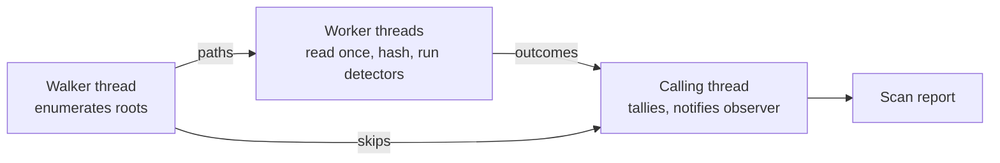

# Architecture

This document describes the design Warden is being built towards and marks
what exists today. The phases are in [ROADMAP.md](ROADMAP.md).

**Implemented so far (phases 1 and 2):** the engine library, the signature
database, hash matching, YARA rules, zip scanning and the command-line tool.

## Scope

Warden is a second-opinion scanner for Windows that runs next to Microsoft
Defender. It is a portfolio project, and its goal is depth in the scan
engine, a clean architecture and measured results, not feature parity with a
commercial product.

What a product such as Malwarebytes has and Warden will not:

- **Threat intelligence.** A vendor's detection quality comes from its
  research team, its telemetry and constant updates. Warden's signatures come
  from public feeds, so its coverage will trail a vendor's by a wide margin.
- **Kernel components for distribution.** Blocking a file before it runs,
  behaviour-based ransomware protection, exploit protection, web filtering
  and rootkit scanning all need kernel drivers. Distributing one requires
  Microsoft's signature, which requires an EV certificate.
- **Protected-process status and Security Center registration.** Both are
  reserved for vendors in Microsoft's Virus Initiative, which is for
  commercially available products.

What Warden does instead is stated as a threat model: it resists
unprivileged malware and casual tampering, detects modification of its own
files, and does not resist an attacker with administrator rights.

## Processes


- **Core service** (phase 6). A Windows service running as SYSTEM. It owns
  the engine, the signature store, the quarantine vault, remediation, the
  real-time monitor and all state. Anything that needs privilege, or must
  keep running with nobody logged in, lives here.
- **Desktop app** (phase 7). Tauri with a React front end, running with the
  user's normal rights. A thin client with no engine code; it cannot delete
  or restore anything by itself.
- **CLI** (phase 1, exists). The same engine linked directly, for
  benchmarks, CI and scripting. From phase 6 it can also drive the service.

The processes talk over a local named pipe with length-prefixed JSON:
requests go down, progress and detection events come back. The service
treats every client as untrusted and checks each request against the
caller's Windows token. Anything that weakens protection (restoring from
quarantine, adding exclusions, switching real-time protection off) needs an
elevated caller.

## Design rules

1. **The engine is a plain library.** No user interface, no service code and
   no Windows-only APIs beyond a few file-opening hints. It can be tested,
   benchmarked and fuzzed in isolation, on any platform.
2. **Detectors report, a policy decides.** A detector returns findings, each
   with a confidence and human-readable reasons. A separate verdict policy
   turns the findings for a file into clean, suspicious or malicious. Every
   detection can therefore answer "why was this flagged?", and a new
   detector never needs to know what the product does about a finding.
3. **Nothing is destroyed.** Quarantine is journaled and reversible, and a
   guard refuses to quarantine signed Windows system files, because a false
   positive there can stop Windows from booting.
4. **Files are hostile input.** Parsers get limits, and fuzz targets from
   phase 3 on. A file that cannot be read is reported as skipped with a
   reason, and a file that could only be checked in part is reported as
   such, with what was left out. Neither is ever silently dropped. A
   detector that panics costs one file, not the scan.

## Workspace layout

```
crates/
  warden-sigdb/     signature database: format, builder, reader, importers
  warden-engine/    detector interface, verdict policy, the parallel scan
                    pipeline, zip unpacking, the hash detector
  warden-yara/      YARA layer: rule bundles and the detector that runs them
  warden-cli/       the `warden` command-line tool
docs/               this document, the roadmap, format specs, testing, benchmarks
rules/              which public rule release the rule bundle is built from
scripts/            fetch and check scripts, for Linux and Windows
```

The YARA layer is a crate of its own because its rule engine is a large
dependency. The engine crate stays small and builds in seconds; only what
needs YARA pays for it.

Crates planned for later phases: `quarantine`, `remediation`, `realtime`,
`ipc`, `service`, and the Tauri app.

## The scan pipeline

Implemented in `warden-engine`.



1. A **walker** thread enumerates the scan roots and queues every regular
   file. It does not follow symbolic links or junctions, and it skips cloud
   placeholders (OneDrive files that are not on disk), because reading them
   would download them.
2. **Worker** threads take paths from a bounded queue. Each file is opened
   without blocking other programs and read exactly once. Its SHA-256 is
   computed on the way.
3. Files up to a size limit are buffered once and shared by all detectors.
   Larger files are still hashed, in a streaming fashion with constant
   memory, and still checked by hash; the report lists them as checked in
   part.
4. Each **detector** inspects the file and returns findings. A detector is
   shared and read-only: signatures, compiled rules. What a thread needs to
   itself, such as a YARA scanner, lives in a **session** that the detector
   hands out once per worker thread.
5. If the file is a zip archive, its members are unpacked in memory and go
   through the same detectors, see [Archives](#archives).
6. The **verdict policy** decides clean, suspicious or malicious from all
   findings for the file, its members included.
7. The **calling thread** collects outcomes, so an observer (a progress
   line today, the service's event stream later) needs no locking.

Both queues are bounded, which gives back-pressure: the walker cannot run
far ahead of the workers and fill memory with paths. A scan can be cancelled
at any time and still returns a report of what it covered.

### Detection layers

| Layer | Phase | What it catches | Its weakness |
|---|---|---|---|
| Hash match | 1, done | Exact copies of known files | One changed byte evades it |
| YARA rules | 2, done | Byte patterns and structure shared by a family | Packing and encryption hide the patterns |
| PE heuristics | 3 | Signs of packing, injection and evasion in executables | Legitimate software can look suspicious |
| ML classifier | 11, optional | Statistical resemblance to known malware | Opaque, and only as good as its training data |

A valid Authenticode signature will be able to lower a heuristic score. It
never cancels a hash or YARA hit.

How a rule match becomes a verdict, where rules come from and what a rule
bundle looks like on disk is in [RULES.md](RULES.md).

### Archives

Implemented in `warden-engine`, for zip archives. That covers plain zips
and everything built on the format: Office documents, Java archives,
installers that carry a zip behind a program.

- **In memory, never to disk.** A member is unpacked into a buffer, hashed,
  handed to the detectors and dropped. Nothing is written anywhere, so a
  member named `..\..\evil.exe` is only a name.
- **A finding says where.** The detection is the file on disk, because that
  is what can be quarantined. The finding carries the path inside it, for
  example `inner.zip > tools/setup.exe`, with the member's own size and
  hash.
- **Every limit is reported.** An archive is hostile input: a few kilobytes
  can claim to unpack to petabytes. When a limit stops the unpacking, the
  file is listed as checked in part, with the limit that stopped it.

| Limit | Default | Guards against |
|---|---|---|
| Nesting depth | 3 archives | Archives inside archives without end |
| Members per scanned file, all levels together | 10,000 | Millions of tiny members |
| Size of one member, unpacked | 64 MiB | One member that fills memory |
| Unpacked total per scanned file | 512 MiB | Many members that add up |
| Compression ratio of one member | 250 to 1, for members above 1 MiB | A small member that explodes |

The member limit matches the default of ClamAV's `MaxFiles`. A member is
never trusted about its own size: unpacking stops at the limit, whatever
the archive's directory says.

Also reported instead of silently skipped: members that are
password-protected, members packed with a method that this build does not
unpack (it unpacks stored, deflate and deflate64), and archives that are
damaged. A damaged member is still checked as far as it unpacks, so a
deliberately broken tail is not a way past the scanner.

Known gaps, by decision:

- Archives larger than the content limit (128 MiB) are not unpacked, and
  other formats (7z, rar, cab, iso) are not unpacked at all.
- Warden reads an archive the way Windows Explorer and 7-Zip do, through
  its central directory. A file crafted so that other tools see different
  members than that directory lists is not detected as such.
- The most compact zip bombs list the same packed data under many directory
  entries. That overlap is not detected as such either: each entry is
  unpacked as a member of its own, and the limits above end it.

## Signature database

Implemented in `warden-sigdb`. A sorted table of SHA-256 digests with a
16-bit prefix index, memory-mapped and verified in full on open. The format
is specified in [SIGDB_FORMAT.md](SIGDB_FORMAT.md).

## Quarantine and remediation (phases 4 and 5)

- **Quarantine.** Encrypt the file into a vault closed to normal users,
  verify the copy, record the original path, hash, timestamps and
  permissions, then remove the original, at the next reboot if it is locked.
  Restore reverses this, checks the hash, and refuses to write through
  junctions or symbolic links, which is the classic way a SYSTEM-level
  restore gets abused.
- **Remediation.** One enumerator each for registry Run keys, scheduled
  tasks, services and startup folders, each resolving an entry to the file it
  launches. Quarantining a file removes the entries that point at it and
  stores them in the quarantine record, so that restore puts them back.

## Real-time protection (phase 9)

- A watcher on high-risk folders (Downloads, Desktop, Temp, AppData, startup
  folders) scans files as they land.
- A process-start monitor scans each new process image. A malicious verdict
  kills the process and quarantines the file.
- An alert fires when a new autostart entry appears.

User mode hears about events after they happen, so a file can start running
before the verdict arrives. This is detect-and-respond, not prevention, and
the measured delay will be published. Blocking before execution needs a
filter in the kernel's I/O path that holds the operation until a scanner
answers; that is the optional, VM-only phase 12.

## Self-protection (phase 10)

In user mode the service will:

- run as SYSTEM with tightened service and process permissions, so that
  unprivileged processes cannot stop it, kill it or inject into it;
- lock its install folder, signature store, vault and registry keys with
  explicit ACLs, and hold critical files open so they cannot be swapped
  while it runs (the signature database already does this);
- verify its own binaries and signatures against a signed manifest at
  startup, which detects tampering but does not prevent it;
- restart through the service manager if killed;
- avoid being the vulnerability itself: quoted service path, safe DLL
  loading, nothing user-writable in its load chain.

Where that stops is an administrator. With the debug privilege enabled, a
process's security descriptor no longer limits what `OpenProcess` hands out,
and administrators hold that privilege by default. An administrator can also
stop or delete the service, rewrite its ACLs or load a driver. Vendors get
past this with kernel help: protected-process status, which depends on an
early-launch driver that only Virus Initiative members can have signed, and
drivers that strip dangerous rights from handles opened to their processes.

## References

- [Microsoft: Driver signing](https://learn.microsoft.com/windows-hardware/drivers/install/driver-signing)
- [Microsoft: Protecting anti-malware services](https://learn.microsoft.com/en-us/windows/desktop/Services/protecting-anti-malware-services-)
- [Microsoft: Early launch antimalware prerequisites](https://learn.microsoft.com/en-us/windows-hardware/drivers/install/elam-prerequisites)
- [Microsoft Virus Initiative criteria](https://learn.microsoft.com/en-us/defender-xdr/virus-initiative-criteria)
- [Microsoft: OpenProcess](https://learn.microsoft.com/en-us/windows/win32/api/processthreadsapi/nf-processthreadsapi-openprocess)
- [Microsoft: security products and Windows Security Center](https://support.microsoft.com/en-us/kb/5011295)
- [Microsoft: Scanner file system minifilter sample](https://learn.microsoft.com/en-us/samples/microsoft/windows-driver-samples/scanner-file-system-minifilter-driver)
